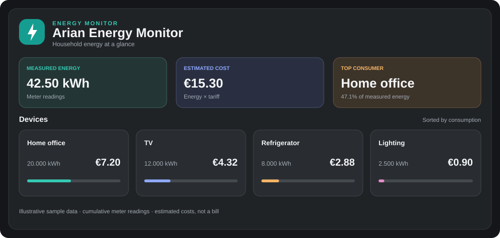

# Arian Energy Monitor

A responsive Home Assistant dashboard card for device-level energy and estimated electricity costs. Designed from an idea by Arian and developed collaboratively with ChatGPT.

**Current release: v0.3.1 beta** - cumulative device meters and interactive consumption history.

## What's new in v0.3.1

- Built-in historical charts: today (hourly), last 7 days (daily), current month (daily), and current year (monthly).
- Switch between energy (kWh) and estimated costs in the selected currency. Colored columns show the contribution of each configured device.
- Uses Home Assistant's existing Recorder statistics; no additional sensors or YAML are required if your energy sensors already provide statistics.
- Existing card configurations remain compatible. Update from Marketplace, then refresh your browser.

**Deutsch:** Neu sind integrierte Verbrauchsdiagramme für heute, die letzten 7 Tage, den aktuellen Monat und das aktuelle Jahr. Wechsel zwischen kWh und geschätzten Kosten; bestehende Karten bleiben kompatibel.

**Türkçe:** Bugün, son 7 gün, bu ay ve bu yıl için kartın içinde tüketim grafikleri eklendi. kWh ile tahmini maliyet arasında geçiş yapılabilir; mevcut kart ayarları korunur.

History requires energy sensors with recorded sum statistics (normally `total` or `total_increasing`). Missing statistics are excluded, rather than treated as measured zero; a new sensor may need time to accumulate history. Historical cost is estimated using the **current configured tariff**, not past tariffs or a utility bill.

[](https://my.home-assistant.io/redirect/marketplace_repository/?owner=Argabor77&repository=arian-energy-monitor&category=plugin)



## Installation — no code required

1. Click the **Install** badge above and open your own Home Assistant.
2. Add the repository when prompted, then install it in Marketplace.
3. Refresh the browser, edit any dashboard, and add **Arian Energy Monitor**.
4. Enter a tariff, select a currency and choose the energy sensors in the visual editor.

Alternatively, in Settings > Marketplace > Add from link, use `Argabor77/arian-energy-monitor` (Dashboard).
The older Home Assistant community store also accepts this repository as a custom Dashboard repository.

### Deutsch

Auf den Installationsbutton klicken, das Repository hinzufügen und installieren.
Danach die Seite neu laden, im Dashboard die Karte **Arian Energy Monitor** hinzufügen und Strompreis, Währung und Energiesensoren im visuellen Editor einstellen.

### Türkçe

Yukarıdaki kurulum bağlantısına tıklayın, depoyu Marketplace'e ekleyip yükleyin.
Tarayıcıyı yenileyin, dashboard'a **Arian Energy Monitor** kartını ekleyin.
Elektrik tarifesini, para birimini ve enerji sensörlerini görsel editörden seçin. Kod yazmanız gerekmez.

All calculations run locally inside the Home Assistant frontend. The card does not send readings to an external service.

## Install manually

1. Download `arian-energy-monitor.js` from the release assets.
2. Place it in Home Assistant's `www` directory (usually `/config/www/`).
3. In Settings → Dashboards → Resources, add `/local/arian-energy-monitor.js?v=0.3.1` as a JavaScript module.
4. Refresh your browser. Edit a dashboard and select **Arian Energy Monitor** in the card picker.
5. Enter your tariff, choose the currency, and add energy sensors with your preferred names, icons and colors.

No additional integration or API token is required. For an upgrade, replace the JS file and change the version suffix on the resource URL.

## Example configuration

```yaml
type: custom:arian-energy-monitor
tariff: 0.36
currency: EUR
language: de
devices:
  - entity: sensor.example_energy
    name: Computer
    icon: mdi:desktop-tower
    color: '#35c9b3'
```

The example entity is a placeholder. Choose your own energy sensor in the visual editor. Supported energy units: Wh, kWh and MWh. W is power, not energy.

The card normalizes energy to kWh, ignores unavailable and invalid measurements, prevents duplicate entity IDs from being summed twice, and multiplies measured kWh by the configured tariff. It does not infer whether different sensors meter the same physical load; do not select both a parent meter and its submeter if doing so double-counts consumption. Meter reset dates can differ. The total is not a utility bill and excludes unmonitored devices and fixed charges.

The interface supports English, German and Turkish, with automatic Home Assistant language selection. A device tile opens the standard entity details dialog.

## Development

Run `node --test arian-energy-monitor.test.cjs` to check the calculation helpers.

## License

MIT. See LICENSE.
